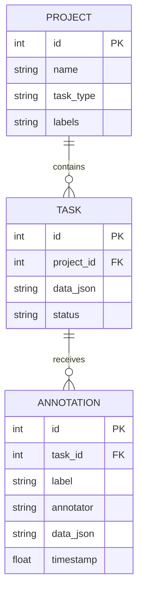

# LLM Annotation Studio

This subproject is part of the ai-core-infra modular AI infrastructure. It implements a complete interactive web platform (local Full-Stack) for data labeling and annotation aimed at training language models, enabling efficient workflows for classic Natural Language Processing (NLP) tasks and human alignment (Human-in-the-Loop).

For this system a single-page application (SPA) was built, connecting to a FastAPI backend and a relational SQLite database for structured, secure storage of local annotations, making later export for model fine-tuning easier.

## Data Architecture and Relationships

The backend uses SQLAlchemy to manage referential and foreign-key integrity in a local SQLite database. The relationship structure is represented in the following Entity-Relationship diagram:



## Annotation Mode Specification

### 1. Text Classification
Simple categorical labeling. The annotator selects one of the project's labels to associate with the task.

### 2. Comparative Alignment (DPO/RLHF)
The task contains two outputs generated by LLMs based on a prompt. The annotator records:
*   Preference (Response A or B).
*   Ordinal rating for each response (1 to 5 stars).
*   Golden Response: direct on-screen editing to refine the best possible response.

### 3. Named Entity Recognition (NER)
DOM-selection-based annotator. Records absolute physical character indices over the text:

$$\text{Annotation} = [S_{\text{start}}, S_{\text{end}}, L_{\text{label}}, T_{\text{text}}]$$

Where $S_{\text{start}}$ is the inclusive start offset, $S_{\text{end}}$ is the exclusive end offset, $L_{\text{label}}$ is the assigned category, and $T_{\text{text}}$ is the selected substring for auditing.

## REST API Specification (Main Endpoints)

| Method | Path | Description |
| :--- | :--- | :--- |
| `POST` | `/api/projects` | Creates a project with its label configuration and task type. |
| `GET` | `/api/projects` | Lists all active projects in the database. |
| `GET` | `/api/projects/{id}/tasks` | Retrieves all tasks (pending and annotated) associated with a project. |
| `POST` | `/api/projects/{id}/tasks` | Bulk-loads tasks by sending a JSON collection of records. |
| `POST` | `/api/tasks/{id}/annotations` | Records a new annotation in place, marking the task as completed. |
| `GET` | `/api/projects/{id}/export` | Exports the dataset in a format suitable for training (e.g. DPO pairs or NER tuples). |
| `GET` | `/api/tokenize` | Interaction endpoint that receives a text and returns the token count via the neighboring module. |

## Installation Requirements

*   Python 3.10 or higher
*   FastAPI
*   SQLAlchemy
*   Uvicorn
*   HTTPX (for integration tests)

To install the web server requirements, run:
```bash
pip install -r requirements.txt
```

## Execution and Verification Guide

### 1. Start the Local Server
```bash
python3 main.py
```
The server will be available on port 8000. Access `http://127.0.0.1:8000` in your browser.

### 2. Run Unit Tests
The project has local unit test coverage to validate the API's behavior and the relational database over an isolated temporary environment:
```bash
python3 -m unittest test_main.py
```

## Connectivity within the ai-core-infra Ecosystem

`llm-annotation-studio` acts as the human curation node:
*   Consumes [bpe-tokenizer-from-scratch](https://github.com/juanmmm21/bpe-tokenizer-from-scratch) via `/api/tokenize` to show the annotator the token count and physical distribution of the text.
*   The exported JSON dataset feeds fine-tuning in [llm-qlora-finetuner](https://github.com/juanmmm21/llm-qlora-finetuner).
*   The annotated and validated data feeds the automated evaluation harness in [llm-eval-harness](https://github.com/juanmmm21/llm-eval-harness) to measure regressions.
